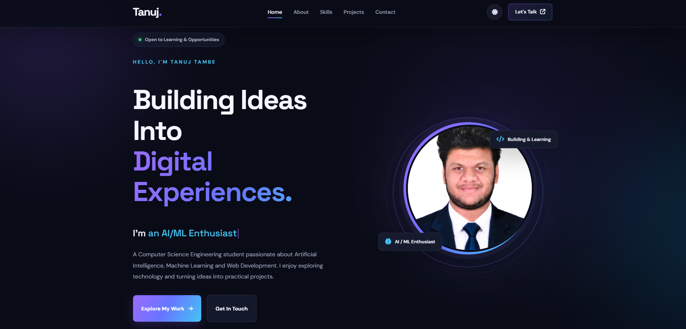
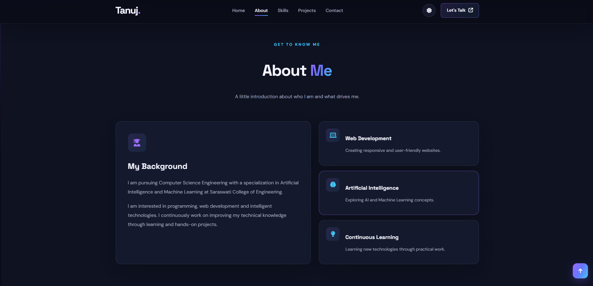
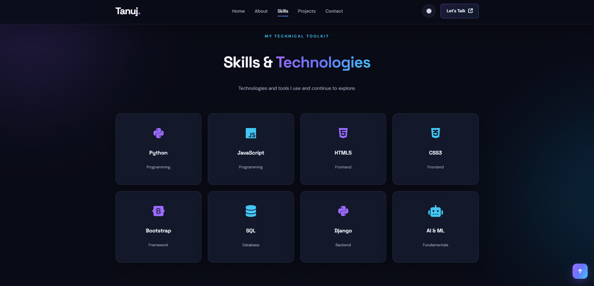
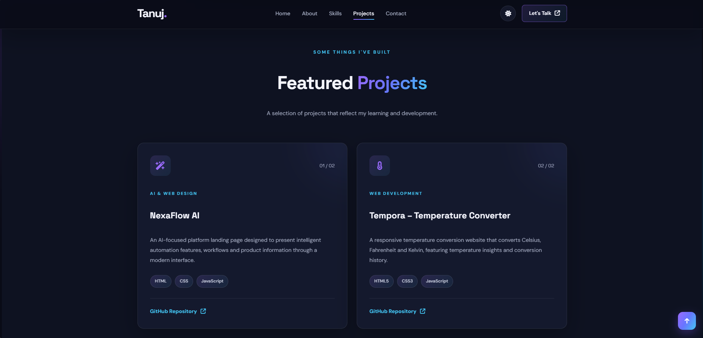
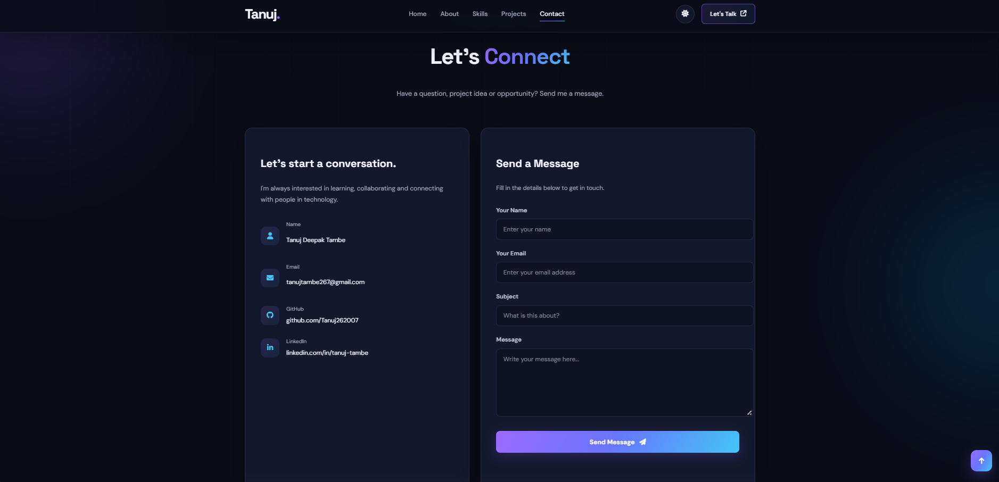

# Personal Portfolio – Tanuj Deepak Tambe

A modern, responsive personal portfolio website designed to showcase my profile, technical skills, projects, and contact information. The website highlights my journey as a Computer Science Engineering student specializing in Artificial Intelligence and Machine Learning.

## 🌐 Project Overview

Personal Portfolio is a frontend web development project created as part of the **Oasis Infobyte Web Development and Designing Internship – Level 1, Task 2**.

The project focuses on building a professional digital presence with a clean, modern UI, responsive layouts, smooth animations, and interactive elements.

## ✨ Features

- Modern and responsive portfolio design.
- Professional hero section with introduction and profile photo.
- Animated typing text effect.
- About Me section highlighting my background and interests.
- Technical skills section.
- Projects showcase featuring my development work.
- Contact section with an interactive contact form.
- EmailJS integration for handling contact form enquiries.
- Dark and light mode toggle.
- Smooth scrolling and section navigation.
- Scroll reveal animations.
- Mobile-friendly navigation.
- Back-to-top button.
- Responsive layouts for different screen sizes.

## 🛠️ Technologies Used

- **HTML5** – Website structure and content.
- **CSS3** – Styling, layouts, animations, and responsiveness.
- **JavaScript** – Interactive functionality and dynamic elements.
- **EmailJS** – Contact form email integration.
- **Google Fonts** – Modern typography.

## 📸 Website Screenshots

### 1. Homepage


### 2. About Me


### 3. Skills Section


### 4. Projects Section


### 5. Contact Section


## 📂 Project Structure

```text
Personal-Portfolio/
│
├── index.html
├── style.css
├── script.js
│
├── Assets/
│   └── tanuj-profile.jpg
│
├── screenshots/
│   ├── homepage.png
│   ├── about.png
│   ├── skills.png
│   ├── projects.png
│   └── contact.png
│
└── README.md
```

## 🚀 How to Run Locally

1. Clone this repository:

   ```bash
   git clone YOUR_REPOSITORY_URL
   ```

2. Open the Personal Portfolio project folder.

3. Open `index.html` in your browser or use the Live Server extension in VS Code.

4. To enable the contact form, configure your EmailJS credentials in `script.js` and ensure your EmailJS template is set up correctly.

No additional dependencies or installations are required.

## 🎯 Internship Details

| Detail | Information |
|---|---|
| Organization | Oasis Infobyte |
| Internship Track | Web Development and Designing |
| Level | Level 1 |
| Task | Task 2 – Personal Portfolio |
| Project | Personal Portfolio Website |
| Technologies | HTML5, CSS3, JavaScript, EmailJS |

## 👨‍💻 Author

**Tanuj Deepak Tambe**

B.Tech – Computer Science and Engineering (AI & ML)

- GitHub: [Tanuj262007](https://github.com/Tanuj262007)
- LinkedIn: [Tanuj Tambe](https://www.linkedin.com/in/tanuj-tambe/)
- Email: tanujtambe267@gmail.com

---

*Built with curiosity, creativity, and a passion for technology and web development.*
